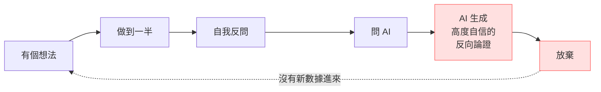

---
{"dg-publish":true,"permalink":"/jet-note/thinking/ai/","title":"AI 的認知風險 — 流暢度偽裝成證據","tags":["AI-Agent","Decision-Making","Epistemics"],"dg-note-properties":{"title":"AI 的認知風險 — 流暢度偽裝成證據","tags":["AI-Agent","Decision-Making","Epistemics"],"created":"2026-10-29"}}
---


# AI 的認知風險 — 流暢度偽裝成證據

> 核心命題：**AI 是放大器，不是判斷者。** 它能為任何立場生成可信的論證 —— 包含錯的那一方。
>
> 這篇講的是「**認知面**」的風險（如何不被 AI 誤導），
> 與 [[ AI Agent 協作邊界筆記\| AI Agent 協作邊界筆記]] 的「**控制面**」（如何約束 AI 的行為）互補。
> 前者問「怎麼讓 AI 照著做」，這篇問「怎麼不照著 AI 做」。

---

## 一、問題：AI 的輸出會被當成證據

AI 的回應有兩個性質，容易被誤讀成第三個：

| 實際性質 | 容易被誤讀為 |
| --- | --- |
| 語意連貫、結構完整、語氣確定 | 內容正確 |
| 能引用名詞、數字、來源名稱 | 有實證依據 |
| 能同時生成正反兩方的論證 | （不會被誤讀，但會讓人以為「兩邊都有道理」） |

**流暢度是風格，不是證據。**

### 反例（真實發生）

同一個決策問題，**兩個 AI 給出相反、但同樣自信的結論**：

```
AI-A：這個方向可行，理由是 …（結構完整）
AI-B：這個方向不可行，理由是 …（結構完整）

兩者都：語氣確定、段落分明、有論據、有數據引用
```

**這件事本身就是結論：**

> 如果 AI 能同樣自信地得出相反答案，那 AI 就不是裁判。

---

## 二、三個具體機制

### 2.1 未驗證就先下判斷

AI 在資訊不足時不會說「我不知道」，而會**用合理的推理補上缺口，然後以完整的語氣輸出**。

危險的不是判斷本身，而是**判斷強度與驗證程度不成比例**：

| 實例 | 用了多少資訊 | 輸出的強度 |
| --- | --- | --- |
| 用參數區間裡最差的那一端推算整個模型 | 單一參數 | 「不可行」 |
| 觀察到一個現象（且不知是否為暫時性） | 單次觀察 | 「這是嚴重問題」 |

**檢查方式：這個判斷的強度，對得上它的驗證程度嗎？**

### 2.2 可得性偏誤的機器版

AI 能**瞬間生成任何立場的可信論證**。

這使得「我問了 AI，它說不行」變成一個**廉價的反對票** —— 成本幾乎為零，但外觀與深思熟慮的結論無異。

人腦的可得性偏誤是「容易想到的例子顯得常見」；AI 讓這個偏誤變成**可量產**的。

### 2.3 論證的自我強化迴圈



**這個迴圈的特徵：整圈沒有任何新的客觀資訊。**

它只是把「不確定」轉換成「確定的反對」。放棄的理由不是「有新證據」，而是「有人把疑慮講得很有道理」。

---

## 三、可操作的判準

### 3.1 要求 AI 標示「數據」與「推論」

提問時明確要求：

> 「請把**這是數據（有出處的事實）**和**這是推論（你的判斷）**分開寫。」

**效果**：推論一旦被標示，就失去了證據的外觀。

**延伸**：也適用於要求 AI 標示「已知／未知」。強迫它說出「這我不知道」，比事後抓錯便宜。

### 3.2 兩個 AI 給出相反結論 → 這題沒有數據

| 情況 | 意義 | 該做什麼 |
| --- | --- | --- |
| 多數來源一致 | 可能已有共識 | 仍要檢查來源等級 |
| **AI 們結論相反** | **這題缺客觀數據** | **去拿數據，不要投票** |

**不要用「哪個 AI 比較可信」來決定 —— 那是用風格投票。**

### 3.3 追問：替代方案是什麼？

被否定時，追問一句：

> 「如果不做 A，那 B 是什麼？」

| 回應 | 判讀 |
| --- | --- |
| 給出具體替代方案 | 這是**戰略**，值得評估 |
| 只說「A 不行」 | 這是**勸退**，不是戰略 |

**沒有替代方案的否定，不構成決策依據。**

### 3.4 把批評拆成「診斷」與「處方」

一個批評通常包含兩部分，**必須分開評估**：

| 部分 | 例子 | 可能狀態 |
| --- | --- | --- |
| **診斷**（你哪裡有問題） | 「你把時間花在技術細節上，策略面沒跟上」 | 可能**成立** |
| **處方**（所以你該怎麼做） | 「所以你應該放棄這個方向」 | 可能**毫無依據** |

兩種常見錯誤：

- **因為處方錯，就整包丟掉** → 連成立的診斷一起丟
- **因為診斷對，就整包接受** → 連沒依據的處方一起接受

---

## 四、檢查清單

想接受或拒絕一個 AI 的結論之前：

- [ ] 這個結論的**強度**，對得上它的**驗證程度**嗎？
- [ ] 它標示了哪些是**數據**、哪些是**推論**嗎？
- [ ] 我是不是拿了另一個 AI 的相反結論來「投票」？（那是無效的）
- [ ] 被否定時，對方給了**替代方案**嗎？
- [ ] 這個批評的**診斷**與**處方**，我分開評估了嗎？
- [ ] 如果要驗證，**最便宜的那個數據**在哪裡？（見 [[決策前先寫規則 — 事前承諾書與放棄檢查]]）

---

## 五、口訣

| 口訣 | 意思 |
| --- | --- |
| **流暢不是證據** | 風格與正確性無關 |
| **AI 是放大器** | 它放大你帶進去的方向，不判斷方向 |
| **兩個 AI 相反 = 沒有數據** | 去拿數據，不要投票 |
| **沒給替代方案的否定是勸退** | 不構成決策依據 |
| **診斷與處方分開算** | 一個可能對，另一個可能全錯 |

---

## 六、一句話版本

> **AI 能為任何立場生成可信的論證 —— 所以它不能當裁判。**
> **要求它標示數據與推論；兩個 AI 相反時去拿數據；被否定時追問替代方案；批評要拆成診斷與處方。**
