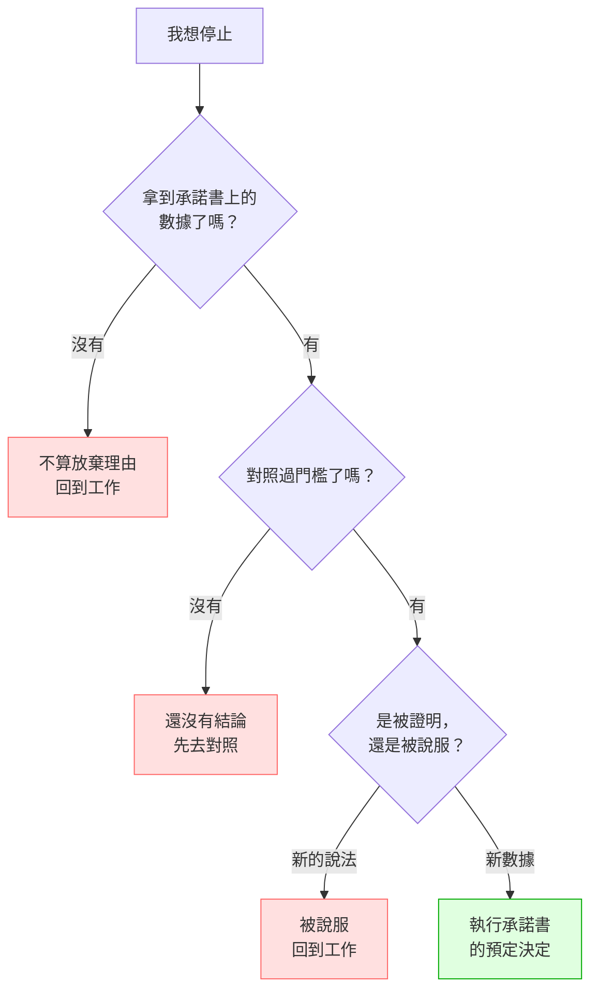

---
{"dg-publish":true,"permalink":"/jet-note/thinking//","title":"決策前先寫規則 — 事前承諾書與放棄檢查","tags":["Decision-Making","Metacognition"],"dg-note-properties":{"title":"決策前先寫規則 — 事前承諾書與放棄檢查","tags":["Decision-Making","Metacognition"],"created":"2026-10-29"}}
---


# 決策前先寫規則 — 事前承諾書與放棄檢查

> 核心命題：**決定規則必須寫在辯論之前。**
> 因為辯論之後，你一定會被說服 —— 往任何方向。
>
> 這篇處理一個特定弱點：**邏輯能力強、但容易被說服的人，如何在缺乏主見的情況下仍做出好決策。**
> 解方不是「變固執」（那違反天性、也做不到），而是**把主見外部化成一份事前寫好的規則**。

---

## 一、為什麼「想清楚再決定」會失效

多數人的決策流程是：

```
蒐集資訊 → 討論 → 想清楚 → 決定
```

**問題藏在最後兩步之間**：討論與思考會**改變你**。

等到「決定」的那一刻，你已經不是開始時那個你了 —— 你**被最後一個說服你的人決定了**。

對容易被說服的人來說，這個流程的輸出不是「最好的決定」，而是**「最後發言者的決定」**。

### 反例（真實發生）

一個方向做到一半，自己反問「這真的可行嗎」，然後問 AI。
AI 生成一份結構完整的反向論證 → 放棄。

**整圈的客觀資訊量是零。**

放棄的理由不是「有新證據」，而是「有人把疑慮講得很有道理」。

---

## 二、機制：事前承諾書

**在聽到任何論點之前**把以下填完。**填完才准開工。**

```
【事前承諾書】專案：____________　日期：______

1. 我要驗證的假設（一句話）：
   ______________________________________

2. 我要看的數據（一個具體數字）：
   ______________________________________
   從哪裡拿：____________________　成本：____　期限：____

3. 門檻：這個數字 大於／小於 ____ 才算成立

4. 每種結果對應的決定（先寫，事後不能改）：
   - 數字 ____ 以上 → 繼續，下一步是 __________
   - 數字 ____ 到 ____ → 調整 __________，但不加碼
   - 數字 ____ 以下 → 停止

5. 時限：____ 週內不下結論、不重新評估方向

6. 可逆性檢查：
   花了什麼？__________　能不能退？______　幾天內？______
```

### 為什麼一定要「事前」

| 時機 | 你的狀態 | 規則的品質 |
| --- | --- | --- |
| **辯論前** | 中立，只看目標 | **穩定** |
| 辯論後 | 已被最有說服力的論點塑形 | **會被改成符合結論的樣子** |

> **事後的「理性檢討」不是檢討，是事後合理化。**

### 這不是新概念（誠實揭露）

| 領域 | 既有做法 | 做什麼 |
| --- | --- | --- |
| 科學研究 | **pre-registration** | 先註冊假設與分析方法，避免事後挑數據 |
| 專案管理 | **pre-mortem** | 先假設專案失敗，再回頭找原因 |
| 投資紀律 | **機械化規則** | 避免在情緒當下做決定 |

**這篇的差別在於把它用在「與 AI 協作」的情境上。**
AI 讓「生成一份可信的反向論證」變成零成本，因此事前承諾書的必要性**上升**，不是下降。

---

## 三、放棄前的三道檢查

當你想停止時，**照順序**問：

### 檢查 1：我拿到承諾書上那個數據了嗎？

- 沒有 → **這不算放棄的理由。回到工作。**
- 有 → 進檢查 2

### 檢查 2：門檻是多少？現在到哪？

- 沒對照過門檻 → **還沒有結論可言**

### 檢查 3：我現在想停，是因為「新數據」還是「新的說法」？

| 來源 | 判讀 | 行動 |
| --- | --- | --- |
| **新數據** | 這是被證明 | 對照承諾書；規則若被滿足，執行它 |
| **新的說法／論點** | 這是被說服 | **不算。回到工作。** |



### 一句話版本

> ### 「我是被證明，還是被說服？」

---

## 四、最小阻力數據優先序

要驗證一件事時，**從最便宜的開始**：

| 順序 | 手段 | 成本 | 適用 |
| --- | --- | --- | --- |
| 1 | **一行指令**（`curl`、查 API、既有報表） | 秒 | 事實查核、狀態確認 |
| 2 | **免費工具**（關鍵字工具、公開數據） | 30 分鐘 | 市場規模、需求量 |
| 3 | **MVP / 人工實驗** | 天 | 需要真實使用者反應 |
| 4 | **完整建置**（花錢、花時間） | 週～月 | 前三者都拿不到數據時 |

**常見錯誤：直接跳到第 4 步，然後用「還沒驗證」當作放棄的理由 —— 但驗證的成本其實在第 1 或第 2 步。**

> **MVP 的價值不是「快」，是「把主觀判斷換成客觀反饋」。**
> 但 MVP 是「沒有便宜數據時」的手段，不是預設動作。

---

## 五、正向回圈的定義

```
假設 → 最便宜的數據 → 對照門檻 → 決定 → 記錄 → 下一個假設
```

**每個循環必須產出兩樣東西，缺一不算完成：**

1. **一個決定**（繼續／調整／停止）
2. **一條記錄**（為什麼這樣決定、當時的數據是什麼）

**為什麼記錄是必要條件：**
記錄是複利的來源。沒有記錄的循環，下次遇到同一題會從零開始 ——
而「從零開始」正是**被重新說服的最佳條件**。

---

## 六、檢查清單

- [ ] 開工前，承諾書填完了嗎？（含門檻與**每種結果的決定**）
- [ ] 我要看的數據，**最便宜的取得方式**是什麼？
- [ ] 花了錢的東西，**能不能退**、幾天內？
- [ ] 想停止時，是「新數據」還是「新說法」？
- [ ] 這個循環有產出**記錄**嗎？

---

## 七、口訣

| 口訣 | 意思 |
| --- | --- |
| **規則寫在辯論之前** | 事後的檢討是事後合理化 |
| **我是被證明，還是被說服？** | 放棄前的唯一判準 |
| **先拿最便宜的數據** | 一行指令 > 免費工具 > MVP > 花錢建置 |
| **沒記錄就沒有複利** | 每個循環都要留下記錄 |

---

## 八、一句話版本

> **決定規則寫在辯論之前，因為辯論之後你一定會被說服。**
> **想放棄時問：我是被證明，還是被說服？—— 新的說法不算，新的數據才算。**
